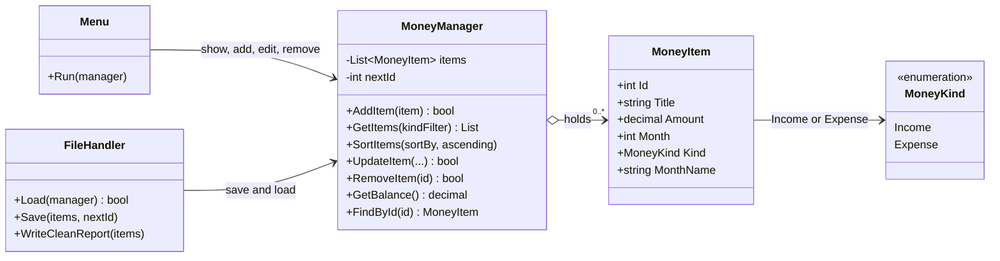
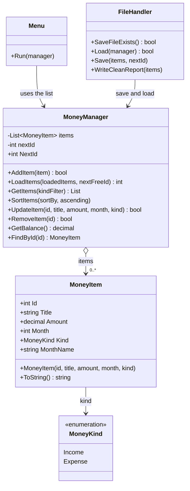

# Money Tracking System

Console application for the individual project **Money Tracking System**.

| | |
|---|---|
| Student | Lotfar Kaes |
| Language | C# |
| Framework | .NET 10 |
| Type | Console application |

This is a simple personal money tracker. It helps users record their income and expenses. An **income** adds money, such as salary. An **expense** takes money away, such as rent. The **balance** is all income minus all expenses. Each row stores a title, an amount, and a month. The list is saved when you quit and loaded again the next time the program starts.

The menu has the same four choices as the project mockup.

---

## How to run

1. Install the [.NET 10 SDK](https://dotnet.microsoft.com/download/dotnet/10.0).
2. Open a terminal in the `InPro1MoneyTracker` folder.
3. Run:

```bash
dotnet run
```

The first start has no saved file. You see a yellow notice and a balance of `0.00 kr`. Add your rows, then choose `4` to quit. The next start reads `Data/money.json` and shows the same rows and the same balance.

Example: save Salary `25000` in January, Rent `8000` in January, and Food `450` in March. The next start shows `16550.00 kr`.

---

## The screen

The main screen is a small dashboard in the console. It still has the same four choices as the course mockup. The title bar says **TRACK MONEY** and **PERSONAL ACCOUNTS**. The **account** box shows the balance (`16550.00 kr` when things look normal, or `(-)350.00 kr` when you owe more than you earned). **Quick operations** are the four numbered actions. **Latest activity** shows your newest rows. **Monthly spending** draws simple bars from your expenses.

```text
  ╔══════════════════════════════════════════════════════════════════════════╗
  ║  TRACK MONEY │ PERSONAL ACCOUNTS                                        ║
  ╚══════════════════════════════════════════════════════════════════════════╝

  ┌─ ACCOUNT ──────────────────────────────────────────────────────────────┐
  │  AVAILABLE BALANCE
  │  16550.00 kr                                    ● In balance
  └─────────────────────────────────────────────────────────────────────────┘

  QUICK OPERATIONS
   1  View history      All items, expenses only, or incomes only
   2  Add transaction   New income or new expense
   3  Edit or remove     Change one row or delete it
   4  Save and quit      Save JSON, report, backup, then exit

  > Select operation (1–4, or type exit / quit / q)
```

A positive balance is green. A negative balance is red with **Overdrawn**. Income rows are green. Expense rows are red. A problem is red. A warning is yellow.

One printed row looks like this:

```text
>> #1  Income  January  Salary  25000.00 kr
```

---

## What you can do

| Choice | What happens |
|---|---|
| `1` | Choose all, expenses, or incomes. Then sort by month, amount, or title, ascending or descending. Press Enter to keep all, month, and ascending. |
| `2` | Choose income or expense, then type a title, an amount, and a month. The new number is shown in green. |
| `3` | Shows the rows, asks for the item number, then edit or remove. Press Enter on an edit question to keep the old value. Remove asks `yes` or `no` first. |
| `4` | Saves the list, writes the clean report, keeps a backup of the previous file, then says goodbye. |
| `exit`, `EXIT`, `quit`, or `q` | Same as `4`. This also works while you are answering a question. |
| A bad title, amount, month, or menu number | A red notice says what to type, and the question is asked again. |

A month can be `3` or `March`. An amount can be `12.50` or `12,50`. An empty title is rejected. An amount must be greater than 0. A removed number is not used again.

Sorting lives inside option 1, so the main menu stays the four lines from the specification.

---

## Requirements

| Requirement | Where it is done |
|---|---|
| An item has a title, an amount, and a month | `MoneyItem` |
| Income and expense are different | `MoneyKind`: `Income` or `Expense`. The amount stays positive. The balance does the minus. |
| Show the list | Menu option 1 |
| Show only expenses, or only incomes | The first question inside option 1 |
| Sort by month, amount, or title, up or down | The next two questions inside option 1 |
| Edit and remove | Menu option 3 |
| Text menu | `Program.cs` starts the app. `Helpers/Menu.cs` shows the menu. |
| Save the list and load it again | `FileHandler` writes `money.json` on quit and reads it at startup |

---

## How saving and loading work

The list in memory disappears when the program closes. `FileHandler` keeps it on disk.

The first quit creates the files. The next quit copies the old `money.json` into `Data/Backups` before it writes the new one. The backup name includes the date and time.

```text
InPro1MoneyTracker/
├── Data/
│   ├── money.json
│   ├── money-report.txt
│   └── Backups/
│       └── money-2026-11-04-1810.json
```

`money.json` is the file the program reads at startup:

```json
{
  "nextId": 4,
  "items": [
    {
      "id": 1,
      "title": "Salary",
      "amount": 25000,
      "month": 1,
      "kind": "Income"
    },
    {
      "id": 2,
      "title": "Rent",
      "amount": 8000,
      "month": 1,
      "kind": "Expense"
    }
  ]
}
```

`nextId` is the next free number. After a load, a new row does not reuse an old number.

`money-report.txt` is the same list in plain columns, so it is easy to open in Notepad:

```text
Id    Kind        Month         Title             Amount
1     Income      January       Salary            25000.00 kr
2     Expense     January       Rent              8000.00 kr
```

If there is no file yet, the program says so and starts empty. If the file is broken, a red notice appears, the program starts empty, and it does not crash. A saved row is skipped when it is incomplete or repeated: it needs a title, an amount above 0, a month from 1 to 12, and a number that is not already used. These data files are listed in the root `.gitignore`, so personal test numbers are not uploaded.

On quit you see:

```text
>> Saved 2 items to Data/money.json.
>> Kept a backup of the previous file in Data/Backups.
>> Wrote a clean report to Data/money-report.txt.
>> Goodbye.
```

The backup line appears only when an older save was already there.

---

## Project structure

The program is small on purpose. `Program.cs` starts it. The menu talks to the user. `MoneyManager` keeps the list. `FileHandler` writes and reads the files.

```text
InPro1MoneyTracker/
├── Program.cs                 Starts the app and loads the saved file
├── Models/
│   ├── MoneyKind.cs           Income or Expense
│   └── MoneyItem.cs           One row: id, title, amount, month, kind
├── Services/
│   ├── MoneyManager.cs        The list, the balance, add, edit, remove, sort
│   └── FileHandler.cs         Save, backup, clean report, and load
├── Helpers/
│   ├── Menu.cs                The menu, show, add, edit, and remove screens
│   ├── ConsoleUi.cs           Dashboard layout on the main screen
│   ├── ColoredText.cs         One colored line, then the old color comes back
│   └── InputHelper.cs         Reads answers and rejects bad input
├── InPro1MoneyTracker.csproj
└── README.md
```

### Simple class diagram

This is a simple picture of the design, the kind the course guide asks for in step 2.4. It shows the main classes, their properties, and their important methods. It is not a map of every helper.

Read the first picture from left to right. The menu is the screen. The manager keeps the rows. Each row is one `MoneyItem`, and `MoneyKind` says if that row is income or expense. `FileHandler` saves and loads the list.



The same five classes, drawn from top to bottom, with the fields written in full:



`MoneyItem` is one row. The amount stays a positive number, and `Kind` says which way the money moves. `MoneyManager` owns those rows while the program is running. `Menu` is what you see on screen. `FileHandler` writes `money.json` and reads it back. `InputHelper` and `ColoredText` help the menu, so they stay out of this picture.

### How the picture works

Each box is one class. The name sits on top. Under the name are the facts the class remembers, then the jobs it can do. The left-to-right picture is the short tour. The top-to-bottom picture writes the same five classes out in full. This is that full picture, in plain words.

A `+` means the rest of the program may use that fact or that job. A `-` means it stays inside the box. An arrow means “this box uses that box.” The words on the arrow say how.

**MoneyKind** is a list of two choices.

- `Income` is money that comes in, like salary.
- `Expense` is money that goes out, like rent.

**MoneyItem** is one row on the list. Think of one line in a notebook.

- `Id` is the row’s own number. The program uses it when you edit or remove that row.
- `Title` is the short name, such as Salary or Food.
- `Amount` is how many kronor. It is always a number above zero. The minus sign shows up only on the balance line.
- `Month` is a number from 1 to 12. 1 means January. 12 means December.
- `Kind` is `Income` or `Expense`.
- `MonthName` turns the month number into a word, such as March. The saved file keeps the number. The word is made when the row is shown.
- `MoneyItem(...)` is how a new row is made. You give it the number, the name, the amount, the month, and the kind, and it fills those in.
- `ToString()` turns the row into one line you can read, such as `#1  Income  January  Salary  25000.00 kr`.

**MoneyManager** is the notebook while the program is open. It holds every row.

- `items` is the private list of rows. Other boxes ask the manager when they need a change.
- `nextId` is the next free number. After row 3, the next new row gets 4. Old numbers are never used again.
- `NextId` lets other boxes read that next number.
- `AddItem` puts one good row on the list. It answers yes when the row is stored. It answers no when the name is empty, the amount is 0 or less, the month is outside 1 to 12, or that number is already on the list.
- `LoadItems` clears the list and fills it from the saved file. A bad row or a repeated number is left out. The method tells how many rows were left out.
- `GetItems` hands back the rows. You can ask for every row, only incomes, or only expenses.
- `SortItems` lines the rows up by month, by amount, or by title. One way is small to large. The other way is large to small. When two rows match, the smaller id comes first.
- `UpdateItem` finds one number and changes its name, amount, month, or kind. It answers no when that number is missing, or when the new facts are too weak to store.
- `RemoveItem` takes one row off the list. It answers no when that number is missing.
- `GetBalance` adds every income, adds every expense, then subtracts. That number is the money you have now.
- `FindById` looks for one number and gives that row back.

**FileHandler** reads and writes the files on the computer.

- `SaveFileExists` looks for `money.json`. It answers yes when the file is there, and no on a first start.
- `Load` reads `money.json` and gives the rows to the manager. When the file is broken, the program says so and starts with an empty list.
- `Save` copies the old file into `Data/Backups`, then writes a new `money.json`.
- `WriteCleanReport` writes `money-report.txt` in straight columns, so the list is easy to read later.

**Menu** is the screen you talk to.

- `Run` shows the welcome line, the balance, and the four choices. It keeps asking until you pick 4 or type exit. Choice 1 shows the rows. Choice 2 adds a row. Choice 3 edits or removes a row. Choice 4 saves the list and says goodbye.

The arrows, in the same plain words:

- The menu points at the manager, because the screen asks the list to show, add, edit, and remove.
- The file helper points at the manager, because it loads rows into the list and saves what the list holds.
- The manager holds zero rows, or many rows. The little diamond means those rows belong to the manager. `0..*` means “none, or as many as you add.”
- Each `MoneyItem` points at `MoneyKind`, because every row is income or expense.

### `MoneyItem`

| Property | Type | Meaning |
|---|---|---|
| `Id` | `int` | The number used to edit or remove the row |
| `Title` | `string` | A short name, such as `Salary` |
| `Amount` | `decimal` | How much money. Always greater than zero |
| `Month` | `int` | `1` for January through `12` for December |
| `Kind` | `MoneyKind` | `Income` or `Expense` |

The constructor sets all five fields. Month names live in one string array, so month `1` is shown as January. `Trim`, `ToLower`, and that array turn both `3` and `March` into the number `3`.

Rent is stored as `8000` and `Expense`, not as a negative amount. Only the balance line uses the minus sign.

### One job for each method

| Method | One job |
|---|---|
| `AddItem` | Put one item in the list and keep the next free number |
| `GetItems` | Return every item, or only incomes, or only expenses |
| `SortItems` | Sort by month, amount, or title, either way |
| `UpdateItem` | Change the title, amount, month, or kind of one id |
| `RemoveItem` | Remove one id |
| `GetBalance` | Income total minus expense total |
| `FindById` | Find one item, or nothing if the number is missing |
| `Load` | Read `money.json` into the list |
| `Save` | Back up the old file, then write `money.json` |
| `WriteCleanReport` | Write `money-report.txt` in columns |

`Program.cs` starts the program and loads the file. `Menu` shows the screen. The list rules live in `MoneyManager`. Filter, sort, and the balance use LINQ. The file rules live in `FileHandler`. A row is stored only when it has a title, an amount above 0, and a month from 1 to 12.

Names use PascalCase for classes and methods (`MoneyItem`, `AddItem`) and camelCase for local variables (`monthNumber`, `cleanTitle`). A comment is used only when the name does not already explain the line.

---

## What was tested

`dotnet build` finished with 0 warnings. These paths were then run. Each one passed.

| Check | What happened |
|---|---|
| Empty list | Show and edit both say there are no items yet. |
| Bad menu number | A red notice asks for 1, 2, 3, 4, or exit. The menu returns. |
| Bad amount | `0` is rejected. The next real amount is accepted. |
| Bad month | A word that is not a month is rejected. `March` is accepted. |
| Sort and filter | Expenses only, by amount, large to small: Rent above Food. |
| Edit | The title changes. Pressing Enter keeps the amount, month, and kind. |
| Delete | Food is removed only after `yes`. It is still gone after a restart. |
| Save and load | Quit, start again, and the balance is `17000.00 kr` for Salary and Rent home. |
| Negative balance | After a large expense the line shows `(-)3000.00 kr`. |
| `EXIT` | Saves the list and says goodbye. |
| `exit` during add | Leaves without adding a half-finished row. The old rows stay in the file. |
| Broken file | A red notice appears. The program does not crash. The old file is copied to `Data/Backups` if you then save. |

---

## How the project was built

The work followed the course development guide, one step at a time.

| Step | Work |
|---|---|
| 1 | Plan features, classes, methods, menu, and files |
| 2 | Create the project and the class files |
| 3 | Put the five properties on `MoneyItem` |
| 4 | Store the objects in `List<MoneyItem>` |
| 5 | Show the console menu in a loop |
| 6 | Add, show, update, and delete |
| 7 | Sort, and show only incomes or only expenses |
| 8 | Save to a file, with a backup and a clean text report |
| 9 | Load the file when the program starts |
| 10 | Test add, edit, delete, sort, bad input, save, load, and exit |
| 11 | Finish this README for handing in |
