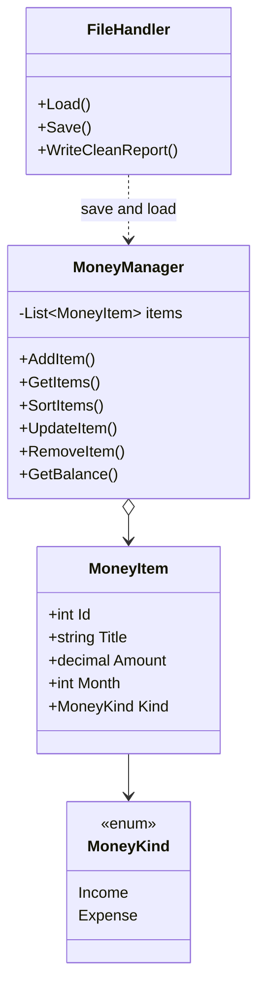

# Money Tracker System

Console application for the individual project **Money Tracking**.

| | |
|---|---|
| Student | Lotfar Kaes |
| Language | C# |
| Framework | .NET 10 |
| Type | Console application |

TrackMoney records money that comes in and money that goes out. An **income** adds money, such as salary. An **expense** takes money away, such as rent. The **balance** is all income minus all expenses. Each row stores a title, an amount, and a month. The list is saved when you quit and loaded again the next time the program starts.

The menu has the same four choices as the project mockup.

---

## How to run

1. Install the [.NET 10 SDK](https://dotnet.microsoft.com/download/dotnet/10.0).
2. Open a terminal in the `InPro1MoneyTracker` folder.
3. Run:

```bash
dotnet run
```

The first start has no saved file. You see a yellow notice and a balance of `0.00 kr`. Add your rows, then choose `4` to quit. The next start reads `Data/money.json` and shows the same rows and the same balance.

Example: save Salary `25000` in January, Rent `8000` in January, and Food `450` in March. The next start shows `16550.00 kr`.

---

## The screen

```text
>> Welcome to TrackMoney
>> You have currently 16550.00 kr on your account.
>> Pick an option:
>> (1) Show items (All/Expense(s)/Income(s))
>> (2) Add New Expense/Income
>> (3) Edit Item (edit, remove)
>> (4) Save and Quit
>>
```

When the balance is below zero, the second line matches the mockup:

```text
>> You have currently (-)350.00 kr on your account.
```

A positive balance is green. A negative balance is red. The welcome line is cyan. Income rows are green. Expense rows are red. A problem is red. A warning is yellow.

One printed row looks like this:

```text
>> #1  Income  January  Salary  25000.00 kr
```

---

## What you can do

| Choice | What happens |
|---|---|
| `1` | Choose all, expenses, or incomes. Then sort by month, amount, or title, ascending or descending. Press Enter to keep all, month, and ascending. |
| `2` | Choose income or expense, then type a title, an amount, and a month. The new number is shown in green. |
| `3` | Shows the rows, asks for the item number, then edit or remove. Press Enter on an edit question to keep the old value. Remove asks `yes` or `no` first. |
| `4` | Saves the list, writes the clean report, keeps a backup of the previous file, then says goodbye. |
| `exit`, `EXIT`, `quit`, or `q` | Same as `4`. This also works while you are answering a question. |
| A bad title, amount, month, or menu number | A red notice says what to type, and the question is asked again. |

A month can be `3` or `March`. An amount can be `12.50` or `12,50`. An empty title is rejected. An amount must be greater than 0. A removed number is not used again.

Sorting lives inside option 1, so the main menu stays the four lines from the specification.

---

## Requirements

| Requirement | Where it is done |
|---|---|
| An item has a title, an amount, and a month | `MoneyItem` |
| Income and expense are different | `MoneyKind`: `Income` or `Expense`. The amount stays positive. The balance does the minus. |
| Show the list | Menu option 1 |
| Show only expenses, or only incomes | The first question inside option 1 |
| Sort by month, amount, or title, up or down | The next two questions inside option 1 |
| Edit and remove | Menu option 3 |
| Text menu | `Program.cs` starts the app. `Helpers/Menu.cs` shows the menu. |
| Save the list and load it again | `FileHandler` writes `money.json` on quit and reads it at startup |

---

## How saving and loading work

The list in memory disappears when the program closes. `FileHandler` keeps it on disk.

The first quit creates the files. The next quit copies the old `money.json` into `Data/Backups` before it writes the new one. The backup name includes the date and time.

```text
InPro1MoneyTracker/
├── Data/
│   ├── money.json
│   ├── money-report.txt
│   └── Backups/
│       └── money-2026-11-04-1810.json
```

`money.json` is the file the program reads at startup:

```json
{
  "nextId": 4,
  "items": [
    {
      "id": 1,
      "title": "Salary",
      "amount": 25000,
      "month": 1,
      "kind": "Income"
    },
    {
      "id": 2,
      "title": "Rent",
      "amount": 8000,
      "month": 1,
      "kind": "Expense"
    }
  ]
}
```

`nextId` is the next free number. After a load, a new row does not reuse an old number.

`money-report.txt` is the same list in plain columns, so it is easy to open in Notepad:

```text
Id    Kind        Month         Title             Amount
1     Income      January       Salary            25000.00 kr
2     Expense     January       Rent              8000.00 kr
```

If there is no file yet, the program says so and starts empty. If the file is broken, a red notice appears, the program starts empty, and it does not crash. A saved row is skipped when it is incomplete or repeated: it needs a title, an amount above 0, a month from 1 to 12, and a number that is not already used. These data files are listed in the root `.gitignore`, so personal test numbers are not uploaded.

On quit you see:

```text
>> Saved 2 items to Data/money.json.
>> Kept a backup of the previous file in Data/Backups.
>> Wrote a clean report to Data/money-report.txt.
>> Goodbye.
```

The backup line appears only when an older save was already there.

---

## Project structure

```text
InPro1MoneyTracker/
├── Program.cs                 Starts the app and loads the saved file
├── Models/
│   ├── MoneyKind.cs           Income or Expense
│   └── MoneyItem.cs           One row: id, title, amount, month, kind
├── Services/
│   ├── MoneyManager.cs        The list, the balance, add, edit, remove, sort
│   └── FileHandler.cs         Save, backup, clean report, and load
├── Helpers/
│   ├── Menu.cs                The menu, show, add, edit, and remove screens
│   ├── ColoredText.cs         One colored line, then the old color comes back
│   └── InputHelper.cs         Reads answers and rejects bad input
├── InPro1MoneyTracker.csproj
└── README.md
```



### `MoneyItem`

| Property | Type | Meaning |
|---|---|---|
| `Id` | `int` | The number used to edit or remove the row |
| `Title` | `string` | A short name, such as `Salary` |
| `Amount` | `decimal` | How much money. Always greater than zero |
| `Month` | `int` | `1` for January through `12` for December |
| `Kind` | `MoneyKind` | `Income` or `Expense` |

The constructor sets all five fields. Month names live in one string array, so month `1` is shown as January. `Trim`, `ToLower`, and that array turn both `3` and `March` into the number `3`.

Rent is stored as `8000` and `Expense`, not as a negative amount. Only the balance line uses the minus sign.

### One job for each method

| Method | One job |
|---|---|
| `AddItem` | Put one item in the list and keep the next free number |
| `GetItems` | Return every item, or only incomes, or only expenses |
| `SortItems` | Sort by month, amount, or title, either way |
| `UpdateItem` | Change the title, amount, month, or kind of one id |
| `RemoveItem` | Remove one id |
| `GetBalance` | Income total minus expense total |
| `FindById` | Find one item, or nothing if the number is missing |
| `Load` | Read `money.json` into the list |
| `Save` | Back up the old file, then write `money.json` |
| `WriteCleanReport` | Write `money-report.txt` in columns |

`Program.cs` starts the program and loads the file. `Menu` shows the screen. The list rules live in `MoneyManager`. Filter, sort, and the balance use LINQ. The file rules live in `FileHandler`. A row is stored only when it has a title, an amount above 0, and a month from 1 to 12.

Names use PascalCase for classes and methods (`MoneyItem`, `AddItem`) and camelCase for local variables (`monthNumber`, `cleanTitle`). A comment is used only when the name does not already explain the line.

---

## What was tested

`dotnet build` finished with 0 warnings. These paths were then run. Each one passed.

| Check | What happened |
|---|---|
| Empty list | Show and edit both say there are no items yet. |
| Bad menu number | A red notice asks for 1, 2, 3, 4, or exit. The menu returns. |
| Bad amount | `0` is rejected. The next real amount is accepted. |
| Bad month | A word that is not a month is rejected. `March` is accepted. |
| Sort and filter | Expenses only, by amount, large to small: Rent above Food. |
| Edit | The title changes. Pressing Enter keeps the amount, month, and kind. |
| Delete | Food is removed only after `yes`. It is still gone after a restart. |
| Save and load | Quit, start again, and the balance is `17000.00 kr` for Salary and Rent home. |
| Negative balance | After a large expense the line shows `(-)3000.00 kr`. |
| `EXIT` | Saves the list and says goodbye. |
| `exit` during add | Leaves without adding a half-finished row. The old rows stay in the file. |
| Broken file | A red notice appears. The program does not crash. The old file is copied to `Data/Backups` if you then save. |

---

## How the project was built

The work followed the course development guide, one step at a time.

| Step | Work |
|---|---|
| 1 | Plan features, classes, methods, menu, and files |
| 2 | Create the project and the class files |
| 3 | Put the five properties on `MoneyItem` |
| 4 | Store the objects in `List<MoneyItem>` |
| 5 | Show the console menu in a loop |
| 6 | Add, show, update, and delete |
| 7 | Sort, and show only incomes or only expenses |
| 8 | Save to a file, with a backup and a clean text report |
| 9 | Load the file when the program starts |
| 10 | Test add, edit, delete, sort, bad input, save, load, and exit |
| 11 | Finish this README for handing in |