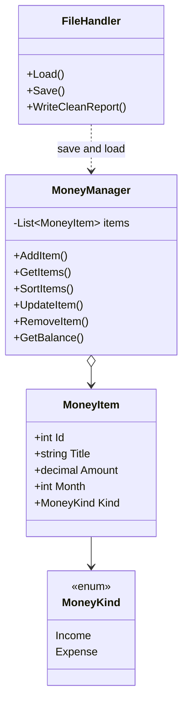

# InPro1MoneyTracker

Individual console project for **Money Tracking**.

| | |
|---|---|
| Student | Lotfar Kaes |
| Language | C# |
| Framework | .NET 10 |
| Type | Console application |
| Status | **Step 4 of 11 — The list** |

`MoneyManager` keeps the items in a `List<MoneyItem>`. The program adds three sample rows and prints them. The menu and saving come in the next steps. The menu on screen will follow the mockup in *Project-2-Money Tracking*.

---

## What the program will do

TrackMoney helps one person write down money that comes in and money that goes out.

- An **income** adds money (salary, gift).
- An **expense** takes money away (rent, food).
- The **balance** is all income minus all expenses.
- Each item has a **title**, an **amount**, and a **month**.
- The list is saved in a file. When the program starts again, the same list comes back.

Example of the first screen (same shape as the project mockup):

```text
>> Welcome to TrackMoney
>> You have currently 1 250.00 kr on your account.
>> Pick an option:
>> (1) Show items (All/Expense(s)/Income(s))
>> (2) Add New Expense/Income
>> (3) Edit Item (edit, remove)
>> (4) Save and Quit
>>
```

When the balance is below zero, the second line looks like the mockup:

```text
>> You have currently (-)350.00 kr on your account.
```

---

## Requirements

Every line below comes from the project specification. This is how this project will meet it.

| Requirement | Plan |
|---|---|
| Model an item with title, amount, and month | Class `MoneyItem` |
| Tell income and expense apart | Property `Kind` (`Income` or `Expense`). The amount is always a positive number. |
| Show the list | Menu option 1 |
| Show only expenses, or only incomes | Inside option 1 the user picks All, Expenses, or Incomes |
| Sort ascending or descending | Inside option 1 the user sorts by month, amount, or title |
| Edit an item | Menu option 3 |
| Remove an item | Menu option 3 |
| Text menu | A loop in `Program.cs`. The menu returns after each job until the user quits. |
| Save the list and load it again | `FileHandler` writes `money.json` on quit and reads it when the program starts |

Extra care, still inside the same small program:

- Colored messages: green when something works, red when it fails, yellow for a warning, cyan for titles.
- Short notices in plain words, for example `Saved 4 items.` or `No item with id 9.`
- The word **exit** works in any mix of letters (`exit`, `EXIT`, `Exit`), and so do `quit` and `q`. They do the same job as option 4: save, then leave.
- A **backup file** is kept before a save replaces the old file.
- A **clean text report** is written beside the JSON file, so the saved data is easy to read.

---

## Classes and properties

Three small types are enough.

### `MoneyKind`

An enum with two values: `Income` and `Expense`.

This is the answer to “distinguish income and expense”. One list holds both kinds. The kind says which way the money moves.

### `MoneyItem`

One row in the tracker.

| Property | Type | Meaning |
|---|---|---|
| `Id` | `int` | A unique number. Used when the user edits or removes a row. |
| `Title` | `string` | A short name, such as `Salary` or `Rent`. |
| `Amount` | `decimal` | How much money. Always greater than zero. |
| `Month` | `int` | `1` for January through `12` for December. |
| `Kind` | `MoneyKind` | `Income` or `Expense`. |

The class has a constructor that sets all five fields. `Program.cs` creates three sample objects and stores them in the list: Salary (income), Rent (expense), and Food (expense).

Why the amount stays positive: the mockup can show a negative **balance**, but one expense is not a negative title. Rent is `8000` and `Expense`. The balance math does the minus sign.

Month names live in one string array, index 1 to 12. The user may type `3` or `March`. Both become the number `3`. That uses string methods (`Trim`, `ToLower`) and the array.

### `MoneyManager`

Holds the list while the program is running.

```csharp
List<MoneyItem> items = new List<MoneyItem>();
```

A list in memory disappears when the program closes. That is why `FileHandler` exists.

| Method | One job |
|---|---|
| `AddItem` | Create one item and add it to the list |
| `GetItems` | Return all items, or only incomes, or only expenses |
| `SortItems` | Sort by month, amount, or title, A to Z or Z to A |
| `UpdateItem` | Change title, amount, month, or kind of one id |
| `RemoveItem` | Remove one id |
| `GetBalance` | Income total minus expense total |
| `FindById` | Return the item, or nothing if the id is missing |

### `FileHandler`

Same idea as a small JSON file helper: one class that only talks to files.

| Method | One job |
|---|---|
| `Load` | If `money.json` exists, read it. If not, start with an empty list and say so. |
| `Save` | Write the list. If an older file is already there, copy it to `Backups` first. |
| `WriteCleanReport` | Write `money-report.txt` in aligned columns. |

Broken JSON must not crash the program. The user gets a red notice, and the program starts with an empty list.

### Helpers

| Class | One job |
|---|---|
| `ColoredText` | Write one line in a chosen console color |
| `InputHelper` | Read a menu choice, a decimal (both `12.50` and `12,50`), a month, and a yes/no answer. Empty titles are rejected. Unknown ids are rejected. Bad menu numbers are rejected. |

`Program.cs` only starts the app, loads the file, and shows the menu. It does not contain the whole program inside `Main`.

---

## Menu plan

The four lines match the specification. Sorting is inside option 1, because the mockup does not add a fifth line, and the requirement still asks for sorting.

| Choice | What happens |
|---|---|
| 1 | Ask: all, expenses, or incomes. Then ask: sort by month, amount, or title, and up or down. Then print the rows. |
| 2 | Ask kind, title, amount, and month. Add the row. Show a green notice with the new id. |
| 3 | Ask the id. Then ask: edit or remove. Edit asks only for the fields the user wants to change. Remove asks `yes` before it deletes. |
| 4 | Save `money.json`, write the clean report, keep a backup, then close. |
| `exit` / `quit` / `q` | Same as 4, in any letter case. |

After 1, 2, or 3, the menu is shown again.

Each printed row will look like this:

```text
Id   Kind      Month      Title            Amount
1    Income    January    Salary           25000.00 kr
2    Expense   January    Rent              8000.00 kr
```

Income rows are green. Expense rows are red. The header is cyan.

---

## Files on disk

Files are created the first time the user quits with option 4. They are not part of the source code.

```text
InPro1MoneyTracker/
├── Data/
│   ├── money.json
│   ├── money-report.txt
│   └── Backups/
│       └── money-2026-11-04-1810.json
```

`money.json` is the file the program loads. Example:

```json
{
  "nextId": 3,
  "items": [
    {
      "id": 1,
      "title": "Salary",
      "amount": 25000.00,
      "month": 1,
      "kind": "Income"
    },
    {
      "id": 2,
      "title": "Rent",
      "amount": 8000.00,
      "month": 1,
      "kind": "Expense"
    }
  ]
}
```

`nextId` is the next free id. After a load, new rows do not reuse an old id.

`money-report.txt` is the clean copy a person can open in Notepad. Same rows, plain text, no brackets.

`Backups` keeps the previous `money.json` before a new save replaces it. The name includes the date and time, so older copies stay.

Personal data files stay out of git. They are listed in the root `.gitignore`.

---

## Folder for the code

This matches a small individual console app: models, services, and the start file.

```text
InPro1MoneyTracker/
├── Program.cs
├── Models/
│   ├── MoneyKind.cs
│   └── MoneyItem.cs
├── Services/
│   ├── MoneyManager.cs
│   └── FileHandler.cs
├── Helpers/
│   ├── ColoredText.cs
│   └── InputHelper.cs
├── InPro1MoneyTracker.csproj
└── README.md
```

These files are in the folder now. `MoneyManager` holds the list. `AddItem` stores one object, and `GetItems` hands the rows back for printing. Edit, remove, sort, and the balance are still outlines. The next step shows the menu.



---

## The 11 steps

From the course development guide. One step is pushed, then the next step starts.

| Step | Work | State |
|---|---|---|
| 1 | Plan features, classes, methods, menu, and files | Done |
| 2 | Create the project and the empty class files | Done |
| 3 | Put real properties on `MoneyItem` and make one object | Done |
| 4 | Store objects in `List<MoneyItem>` | **This commit** |
| 5 | Show the console menu in a loop | Next |
| 6 | Add, show, update, and delete | Waiting |
| 7 | Sort, filter income or expense, and check bad input | Waiting |
| 8 | Save to a file, with a backup and a clean text report | Waiting |
| 9 | Load the file when the program starts | Waiting |
| 10 | Test add, edit, delete, sort, bad input, save, load, and exit | Waiting |
| 11 | Finish this README (how to run, file explanation, screenshots) and publish | Waiting |

---

## How to run

Open a terminal in the `InPro1MoneyTracker` folder and run:

```bash
dotnet run
```

You need the [.NET 10 SDK](https://dotnet.microsoft.com/download/dotnet/10.0).

Right now the program prints the three sample rows that are stored in the list:

```text
>> Welcome to TrackMoney
>> 3 items are in the list:
>> #1  Income  January  Salary  25000.00 kr
>> #2  Expense  January  Rent  8000.00 kr
>> #3  Expense  March  Food  450.00 kr
>> The menu comes in the next step.
```

Income is green. Expenses are red. Nothing is saved yet, and the menu is not on screen yet.

---

## Names and style

- Classes and methods use PascalCase: `MoneyItem`, `AddItem`.
- Local variables use camelCase: `monthNumber`, `cleanTitle`.
- A method does one job.
- A comment is used only when the reason is not obvious from the name.
- No extra features until add, show, edit, remove, sort, save, and load work.